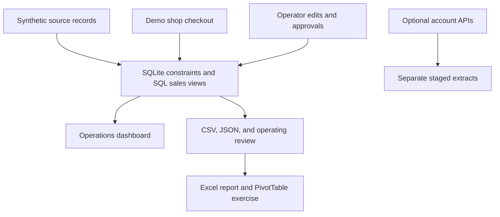

# My architecture and operating routine

I designed my local application around one canonical SQLite data model so that my storefront, operational workflows, and reports share the same business rules.

The core is deliberately small: Python's standard-library HTTP server and SQLite, plus HTML, CSS and JavaScript. There is no third-party runtime package, remote asset dependency, or required paid service. Optional source extracts do not contaminate the synthetic scenario.

## Data flow

1. The deterministic generator creates source records, writes baseline CSVs, and inserts records inside a transaction. The seed is stable and does not reset an existing populated database unless `seed --reset` is requested.
2. SQLite enforces SKU/order relationships, allowed states, inventory floors, returned quantities and discount limits.
3. The `line_sales` view owns cents-based sales/refund/COGS calculations. `order_sales` aggregates to unique orders before customer and order-level analytics.
4. Each request uses a separate database connection. A write transaction begins with `BEGIN IMMEDIATE`, so concurrent buyers cannot both take the same last unit.
5. Checkout computes canonical server-side prices and promotion eligibility. A unique idempotency key protects a retry from creating another order.
6. The UI displays actual JSON responses. Mutations are saved before the workspace refreshes, and exports query the same SQL definitions.

## Local safeguards

The server binds to loopback, checks the Host header, rejects unrelated origins, requires its random local token on mutations, validates inputs, uses parameterized SQL, constrains static-file paths, and records changes. SVG uploads use a small safe subset and reject scripts, event handlers, external references and declarations. Spreadsheet exports escape formula-like untrusted strings.

These controls support a local demo. There are no real user accounts, role-based permissions, production TLS termination, hosted payment flows, webhooks, warehouse reservations, or disaster-recovery operations. Public deployment requires a separate implementation and review.

## Daily operating SOP

| Step | Owner in this scenario | Output |
| --- | --- | --- |
| Check catalog/collection accuracy | E-Commerce and Category | Correct descriptions, approved prices, clear alt text and working imagery |
| Review stock and unshipped orders | Planning & Inventory and Supply Chain | Receipt entries, exceptions, owner and next action |
| Review the next release | E-Commerce Manager | Open prerequisites, due dates, sample/creative progress |
| Confirm creative usage | Creative & Storytelling | Received samples, shoot date, rights note, approval and primary asset |
| Review trading | Analyst | Net sales, order counts, conversion and product/channel differences with caveats |
| Prepare handoff | Analyst and relevant owner | Current operating review and unresolved next actions |

No emails or messages are automatically sent to scenario owners. A handoff is a local record for the portfolio workflow.

## Selected HTTP contract

| Method | Endpoint | Purpose |
| --- | --- | --- |
| GET | `/api/bootstrap` | Dataset date and local request token |
| GET | `/api/summary?start=YYYY-MM-DD&end=YYYY-MM-DD` | Sales and funnel report |
| GET | `/api/operations` | Inventory, findings, launches, assets, orders and handoffs |
| PATCH | `/api/products/{sku}` | Version-checked listing edits, cents as integers |
| POST | `/api/import` | Atomic edited catalog CSV import |
| POST | `/api/checkout` | Transactional synthetic order |
| POST | `/api/receive` | Local stock receipt |
| PATCH | `/api/tasks/{id}` | Dependency-checked status update |
| POST | `/api/launches/{id}/publish` | Gated publication in the demo shop |
| PATCH | `/api/assets/{id}` | Sample/rights/creative review |
| POST | `/api/assets/upload` | Validated replacement SVG |
| POST | `/api/assets/{id}/select` | Approved primary asset selection |
| POST | `/api/issues` | Local team assignment and note |
| GET | `/api/report.csv?kind=excel-lines` | Full current Excel input export |

Read `/api/bootstrap` and pass its `token` as `X-Merch-Token` with `Content-Type: application/json` for mutations. See the tests for concrete request payloads and expected invalid-state responses.
